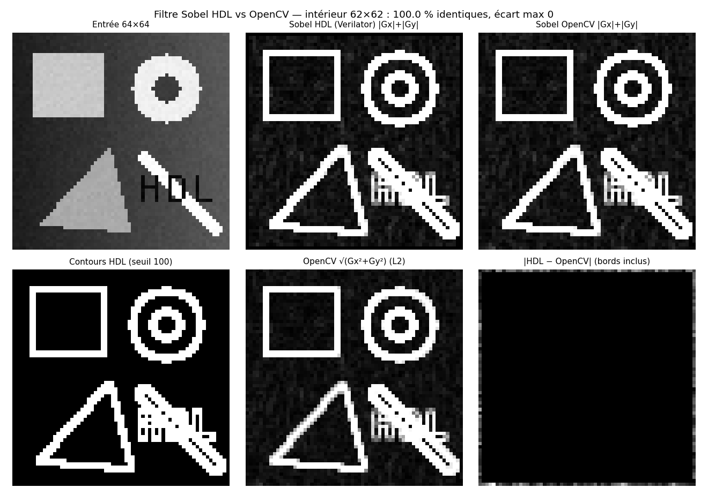
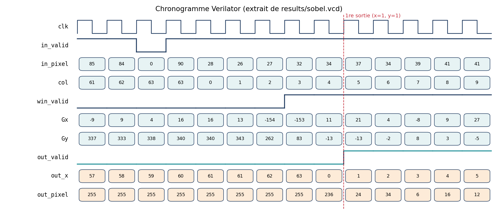

# VHDL_filter_sopel — Pipeline Sobel HDL (Mini-projet 3)

Détecteur de contours **Sobel 3×3** écrit en Verilog, simulé avec **Verilator** et vérifié
**bit à bit** contre **OpenCV**, sur une image de test 64×64 et **en direct avec la caméra**.



| Résultat | Valeur |
|---|---|
| HDL vs OpenCV `|Gx|+|Gy|` (pixels intérieurs) | **100 % identiques, écart max 0** |
| Contours binaires HDL vs OpenCV (seuil 100) | 100 % identiques |
| Débit | 1 pixel / cycle (flux continu) |
| Latence | 3 cycles après le pixel (y+1, x+1) |
| Multiplieurs | 0 (les ×2 sont des décalages) |
| Test caméra 160×120 | PASS sur chaque image, ~4 ms de simulation par image |

---

## Sommaire

1. [Structure du dépôt](#1-structure-du-dépôt)
2. [Prérequis](#2-prérequis)
3. [Démarrage rapide](#3-démarrage-rapide)
4. [Test en direct avec la caméra](#4-test-en-direct-avec-la-caméra)
5. [Architecture matérielle](#5-architecture-matérielle)
6. [Bancs de test](#6-bancs-de-test)
7. [Script Python](#7-script-python)
8. [Commandes et variables du Makefile](#8-commandes-et-variables-du-makefile)
9. [Chronogrammes (GTKWave)](#9-chronogrammes-gtkwave)
10. [Dépannage](#10-dépannage)
11. [Limites et améliorations](#11-limites-et-améliorations)

---

## 1. Structure du dépôt

```
rtl/
  line_buffer.v     2 mémoires de ligne -> colonne verticale (r-2, r-1, r)
  sobel_kernel.v    Gx, Gy, |Gx|+|Gy|, saturation, seuillage (2 étages)
  sobel_top.v       compteurs col/row, fenêtre 3x3, alignement (x, y), frame_done
tb/
  tb_sobel.cpp      banc auto-vérifiant 64x64 : trous aléatoires, modèle C++, VCD
  tb_live.cpp       banc « temps réel » : RTL persistant piloté par stdin/stdout
scripts/
  sobel.py          image de test, références NumPy/OpenCV, métriques, figures
  live.py           test caméra : capture -> RTL simulé -> comparaison OpenCV -> affichage
  figures.py        figures du rapport (architecture, masques, chronogramme)
  make_pdf.py       génération du PDF explicatif (reportlab)
images/             entrée, sorties HDL/OpenCV, différence, comparison.png
results/            sim_log.txt, metrics.json, sobel.vcd, sobel.gtkw
figures/            figures du rapport
docs/               Sobel_HDL_explication.pdf
rapport.md          rapport complet (théorie, architecture, résultats, analyse)
Makefile            toutes les commandes
```

## 2. Prérequis

Testé sous Linux (Debian/Ubuntu) avec Verilator 5.032, g++ (C++17), Python 3, OpenCV 4.10+.

```bash
sudo apt install verilator gtkwave build-essential
pip install numpy opencv-python matplotlib      # + reportlab pour le PDF
```

> Pour le test caméra, il faut la version **`opencv-python`** (avec interface graphique),
> pas `opencv-python-headless`. Vérification :
> `python3 -c "import cv2; print(cv2.getBuildInformation())" | grep GUI`

## 3. Démarrage rapide

```bash
git clone https://github.com/MohamedAzizChouaibi/VHDL_filter_sopel.git
cd VHDL_filter_sopel

make            # compile le RTL + simule l'image 64x64 + compare à OpenCV
make live       # test en direct avec la webcam
```

Sortie attendue de `make` :

```
=== Sobel HDL testbench ===
cycles simulés    : 5071
latence 1er pixel : 161 cycles
pixels émis       : 3844 (attendu 3844)
manquants/doublons: 0 / 0
écarts vs modèle  : 0
RESULTAT          : PASS
...
[compare] HDL == OpenCV (intérieur) : OUI
```

Avec sa propre image : `make IMAGE=photo.jpg THRESH=80` (l'image est mise en 64×64 niveaux de gris).

## 4. Test en direct avec la caméra

```bash
make live                          # caméra 0, 160x120, seuil 100
make live CAM=1                    # autre caméra (/dev/video1)
make live LIVE_W=320 LIVE_H=240    # autre résolution (le RTL est recompilé)
make live CAM=video.mp4            # une vidéo (lue en boucle) ou une image à la place de la caméra
make live-check                    # sans fenêtre : 60 images de la caméra -> PASS/FAIL
```

### Principe

```
 webcam ──► recadrage + niveaux de gris ──► 1 octet seuil + W*H pixels ──► stdin ┐
 (live.py)  + redimensionnement W x H                                            │
                                                                                 ▼
                                                     obj_live/Vsobel_live (tb_live.cpp)
                                                     sobel_top simulé par Verilator,
                                                     1 pixel par front d'horloge
                                                                                 │
 affichage + vérif. ◄── cycles, nb pixels, frame_done, magnitude, contours ◄── stdout ┘
 bit à bit vs cv2.Sobel
```

- Le **même RTL** que pour le test 64×64 est compilé avec `-GWIDTH=160 -GHEIGHT=120`.
  La largeur des compteurs `AW` est calculée automatiquement (`$clog2`).
- Le simulateur reste **lancé pendant toute la session** : pas de reset entre les images.
  Les compteurs `col`/`row` reviennent à 0 tout seuls, ce qui teste aussi l'enchaînement des trames.
- Pour **chaque image**, `live.py` vérifie que :
  - la magnitude HDL est identique à `cv2.Sobel` (`|Gx|+|Gy|` saturé) sur tous les pixels intérieurs ;
  - les contours binaires HDL sont identiques à `cv2.Sobel >= seuil` ;
  - exactement `(W-2)×(H-2)` pixels ont été émis et `frame_done` a été activé.
- Les images en échec sont affichées dans le terminal. À la fin, on obtient `RESULTAT : PASS`
  ou `FAIL` (code de sortie 0 ou 1).

### Fenêtre

| Caméra | Entrée HDL W×H | Sobel HDL `|Gx|+|Gy|` |
|---|---|---|
| **Contours HDL (seuil)** | **Sobel OpenCV** | **\|HDL − OpenCV\| ×50** (noir = identique) |

La barre d'état indique les images par seconde, les cycles par image, le débit en pixels/cycle,
la vitesse de simulation (MHz simulés), le nombre d'images testées et d'échecs, et le verdict
**PASS (bit-exact)** ou **FAIL**.

| Touche | Action |
|---|---|
| `q` / `Échap` | quitter |
| `espace` | pause |
| `+` / `-` | seuil ±10 (ou curseur « seuil ») |
| `s` | capture de la fenêtre -> `images/live_AAAAMMJJ_HHMMSS.png` |

### Options de `scripts/live.py`

| Option | Défaut | Rôle |
|---|---|---|
| `--source` | `0` | index de caméra, fichier vidéo ou image |
| `--width`, `--height` | `160`, `120` | taille de l'image traitée (doit correspondre au build) |
| `--threshold` | `100` | seuil initial des contours |
| `--gap` | `0` | % de cycles sans pixel (`in_valid=0`) pour stresser le pipeline |
| `--frames` | `0` (infini) | arrêt après N images |
| `--no-display` | – | pas de fenêtre (test automatique, CI) |
| `--snapshot` | – | enregistre la dernière vue dans un fichier à la sortie |
| `--sim` | `obj_live/Vsobel_live` | exécutable Verilator |

Exemple de stress test : `python3 scripts/live.py --gap 30 --no-display --frames 50`.

### Performances mesurées (webcam 640×480, 160×120 traité)

| Résolution | Cycles / image | Simulation / image | Images/s affichées |
|---|---|---|---|
| 100×75 | 7 502 | ~1,3 ms | limitées par la caméra |
| 160×120 | 19 202 | ~3–4 ms (~5 MHz simulés) | ~15 (limite de la caméra) |
| 160×120, 30 % de trous | ~27 400 | ~5 ms | limitées par la caméra |

Sans trous : `W×H + 2` cycles par image (2 cycles de vidange du pipeline), donc **1 pixel/cycle**.
Sur FPGA à 100 MHz, ce même circuit traiterait du 640×480 à plus de 300 images/s.

## 5. Architecture matérielle

```
in_pixel ─►┌──────────────┐ t0 (ligne r-2) ┌──────────────┐   ┌───────────────────────────┐
in_valid ─►│ line_buffer  │ t1 (ligne r-1) │ Fenêtre 3x3  │──►│ sobel_kernel              │──► out_pixel, out_edge
           │ 2 × W × 8b   │ t2 (ligne r)   │ 9 registres  │   │ Ét.1 : Gx, Gy (décalages) │    out_x, out_y
           └──────────────┘───────────────►│ à décalage   │   │ Ét.2 : |Gx|+|Gy|, satur.  │    out_valid, frame_done
     compteurs col/row ───────────────────►└──────────────┘   └───────────────────────────┘
```

Masques et calcul :

```
      | -1  0  +1 |          | -1  -2  -1 |
Gx =  | -2  0  +2 |    Gy =  |  0   0   0 |      |G| ≈ min(|Gx| + |Gy|, 255)   (norme L1)
      | -1  0  +1 |          | +1  +2  +1 |      edge = |G| >= threshold
```

- **Largeurs :** pixels sur 8 bits, `Gx, Gy ∈ [−1020, 1020]` sur 11 bits signés, somme ≤ 2040 sur 12 bits, puis saturation à 255.
- **Flux discontinu :** si `in_valid = 0`, la fenêtre et les compteurs restent figés.
- **Bords :** seuls les pixels intérieurs `1 ≤ x ≤ W−2`, `1 ≤ y ≤ H−2` sont émis, avec leurs coordonnées. Les bancs de test mettent le cadre à 0.
- **Paramètres :** `WIDTH`, `HEIGHT`, `DW` (bits par pixel) ; `AW = $clog2(max(WIDTH, HEIGHT))` est calculé automatiquement.

### Interface de `sobel_top`

| Port | Dir. | Largeur | Description |
|---|---|---|---|
| `clk`, `rst` | in | 1 | horloge, reset synchrone actif haut |
| `in_valid` | in | 1 | `in_pixel` est valide pendant ce cycle |
| `in_pixel` | in | DW | pixel en balayage raster |
| `threshold` | in | DW | seuil des contours binaires |
| `out_valid` | out | 1 | sortie valide |
| `out_pixel` | out | DW | magnitude `|Gx|+|Gy|` saturée |
| `out_edge` | out | 1 | `out_pixel >= threshold` |
| `out_x`, `out_y` | out | AW | coordonnées du pixel de sortie |
| `out_gx`, `out_gy` | out | DW+3 signé | gradients (débogage, GTKWave) |
| `frame_done` | out | 1 | impulsion sur le dernier pixel (W−2, H−2) |

## 6. Bancs de test

**`tb/tb_sobel.cpp` (image 64×64, auto-vérifiant)**

1. Il lit `images/input.pgm`, applique un reset, puis envoie les pixels avec `GAP` % de cycles vides aléatoires.
2. Il range chaque pixel de sortie à sa position (`out_x`, `out_y`) et écrit `output_hdl.pgm` et `output_hdl_edges.pgm`.
3. Il compare au modèle de référence C++ et vérifie qu'il y a 3844 pixels, aucun manquant ni doublon, et que `frame_done` a été activé.
4. Il produit la trace `results/sobel.vcd`.

**`tb/tb_live.cpp` (temps réel)**: protocole binaire sur les tubes, pour chaque image :

| Sens | Contenu |
|---|---|
| stdin | 1 octet seuil, puis W×H octets de pixels |
| stdout | `uint32` cycles, `uint32` nombre de pixels émis, `uint32` frame_done, W×H octets magnitude, W×H octets contours |

## 7. Script Python

`scripts/sobel.py` :

| Sous-commande | Rôle |
|---|---|
| `prepare` | scène synthétique 64×64 (dégradé, formes, texte, bruit) ou `--image` -> `images/input.{pgm,png}` |
| `compare` | références NumPy et OpenCV (L1 et L2), métriques (pixels identiques, écart max, MSE, PSNR) -> `results/metrics.json`, `images/comparison.png` |
| `all` | `prepare` + simulation + `compare` |

Détails de l'analyse (écarts sur les bords, L1 vs L2) : voir [`rapport.md`](rapport.md) et [`docs/Sobel_HDL_explication.pdf`](docs/Sobel_HDL_explication.pdf).

## 8. Commandes et variables du Makefile

| Commande | Rôle |
|---|---|
| `make` / `make run` | build + simulation 64×64 + comparaison |
| `make sim` | simulation seule (image déjà préparée) |
| `make lint` | `verilator --lint-only -Wall` |
| `make wave` | ouvre la trace dans GTKWave |
| `make live` | test caméra avec fenêtre |
| `make live-check` | test caméra sans fenêtre, `LIVE_FRAMES` images |
| `make live-build` | compile seulement le simulateur live |
| `make clean` | supprime les builds et les résultats générés |

| Variable | Défaut | Rôle |
|---|---|---|
| `THRESH` | `100` | seuil des contours |
| `GAP` | `20` | % de cycles vides (banc 64×64) |
| `SEED` | `1` | graine des trous aléatoires |
| `IMAGE` | – | image d'entrée personnalisée |
| `CAM` | `0` | caméra, vidéo ou image pour le test live |
| `LIVE_W`, `LIVE_H` | `160`, `120` | résolution du test live |
| `LIVE_FRAMES` | `60` | nombre d'images pour `live-check` |

Figures et PDF : `python3 scripts/figures.py && python3 scripts/make_pdf.py`.

## 9. Chronogrammes (GTKWave)

```bash
make wave
```

`results/sobel.gtkw` affiche dans l'ordre : l'entrée (`in_valid`, `in_pixel`, `col`, `row`), la fenêtre 3×3, `Gx`/`Gy` signés, puis la sortie (`out_valid`, `out_x`, `out_y`, `out_pixel`, `out_edge`, `frame_done`).



## 10. Dépannage

| Problème | Solution |
|---|---|
| `impossible d'ouvrir la caméra 0` | `ls /dev/video*`, essayer `CAM=1` ; ajouter l'utilisateur au groupe `video` (`sudo usermod -aG video $USER`, puis se reconnecter) ; fermer les autres applications qui utilisent la caméra |
| `The function is not implemented ... cvShowImage` | OpenCV sans interface graphique : `pip uninstall opencv-python-headless && pip install opencv-python` |
| Fenêtre Qt qui ne s'ouvre pas sous Wayland | `QT_QPA_PLATFORM=xcb make live` |
| `le simulateur s'est arrêté` | `--width/--height` différents du build : utiliser `make live LIVE_W=.. LIVE_H=..` qui recompile |
| Pas d'écran (SSH, CI) | `make live-check` ou `--no-display` |
| Erreur de compilation Verilator après un déplacement du projet | `make clean` (supprime les anciens `obj_dir/`, `obj_live/`) |

## 11. Limites et améliorations

- **Bords :** répliquer les pixels de bord dans la fenêtre pour obtenir l'image complète, identique à `BORDER_REPLICATE`.
- **Magnitude L2 :** approximation `max + min/2` ou CORDIC.
- **AXI4-Stream** (`tready`, `tlast`, `tuser`) pour gérer la contre-pression et l'intégration dans un SoC.
- **Synthèse FPGA** (Yosys/Vivado) pour mesurer Fmax et les ressources, puis caméra réelle sur la carte (OV7670, HDMI).
