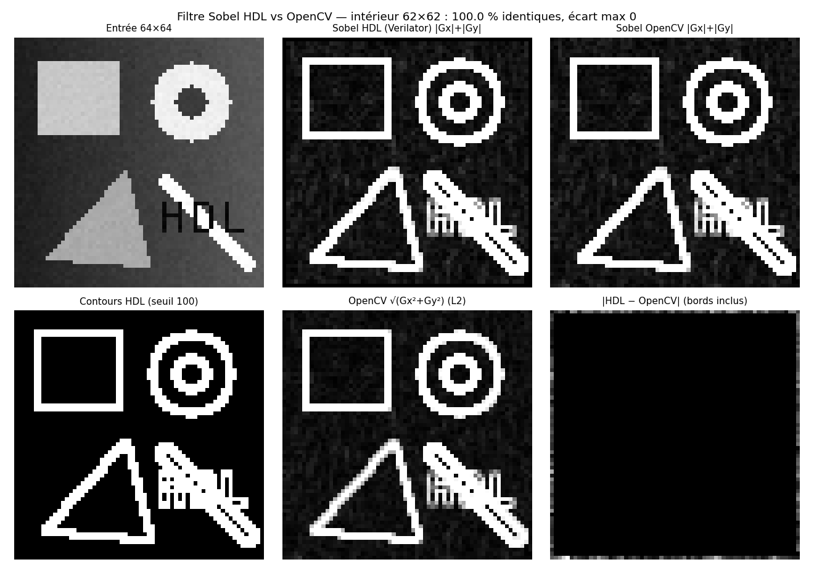
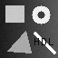
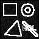
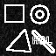
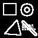

# Mini-projet 3 — Pipeline de traitement d'image HDL : filtre de Sobel

**Outils :** Verilator 5.032, C++17, Python 3 (NumPy 2.3, OpenCV 4.10, Matplotlib), GTKWave

## 1. Objectif

Concevoir en Verilog un pipeline matériel de détection de contours (filtre de Sobel 3×3) qui reçoit un flux de pixels, le tester sur une image 64×64 avec Verilator, puis comparer le résultat matériel à OpenCV.

## 2. Rappel théorique

Le filtre de Sobel estime le gradient de luminosité avec deux masques 3×3 :

```
      | -1  0  +1 |          | -1  -2  -1 |
Gx =  | -2  0  +2 |    Gy =  |  0   0   0 |
      | -1  0  +1 |          | +1  +2  +1 |
```

Pour une fenêtre `p[r][c]` centrée sur le pixel (x, y) :

- `Gx = (p02 + 2·p12 + p22) − (p00 + 2·p10 + p20)`
- `Gy = (p20 + 2·p21 + p22) − (p00 + 2·p01 + p02)`
- Magnitude : `|G| = sqrt(Gx² + Gy²)`. En matériel, on utilise l'approximation **L1** `|G| ≈ |Gx| + |Gy|`, puis on sature à 255.

**Dimensionnement :** avec des pixels de 8 bits, `Gx, Gy ∈ [−1020, +1020]`, donc 11 bits signés suffisent. `|Gx| + |Gy| ≤ 2040` tient sur 12 bits non signés.

## 3. Architecture matérielle

```
in_pixel ─►┌──────────────┐ t0 (ligne r-2) ┌──────────────┐   ┌───────────────────────────┐
in_valid ─►│ line_buffer  │ t1 (ligne r-1) │ Fenêtre 3x3  │──►│ sobel_kernel              │──► out_pixel, out_edge
           │ 2 × 64 × 8b  │ t2 (ligne r)   │ 9 registres  │   │ Ét.1 : Gx, Gy (décalages) │    out_x, out_y
           └──────────────┘───────────────►│ à décalage   │   │ Ét.2 : |Gx|+|Gy|, satur.  │    out_valid
     compteurs col/row ───────────────────►└──────────────┘   └───────────────────────────┘
```

| Fichier | Rôle |
|---|---|
| `rtl/line_buffer.v` | Deux mémoires de ligne de 64 × 8 bits. À chaque pixel valide, elles fournissent la colonne verticale (r−2, r−1, r), puis se décalent (`lb1[c] ← lb0[c]`, `lb0[c] ← pixel`). Une lecture et une écriture par cycle : inférable en BRAM ou LUTRAM. |
| `rtl/sobel_kernel.v` | Masques de Sobel et calcul du gradient en **2 étages** de pipeline. Étage 1 : Gx et Gy, avec des multiplications par 2 réalisées par décalage, donc sans multiplieur. Étage 2 : valeurs absolues, somme, saturation à 255 et seuillage binaire. |
| `rtl/sobel_top.v` | Compteurs de colonne et de ligne, fenêtre 3×3 (9 registres décalés à chaque pixel valide), génération de `win_valid` (fenêtre complète si `row ≥ 2` et `col ≥ 2`), alignement des coordonnées (x, y) avec la sortie, et signal `frame_done`. |

**Caractéristiques :**

- **Débit :** 1 pixel par cycle en régime établi.
- **Flux discontinu :** le flux d'entrée peut comporter des trous (`in_valid = 0`). La fenêtre et les compteurs n'avancent que sur un pixel valide.
- **Latence :** 3 cycles entre l'arrivée du pixel (y+1, x+1) et la sortie du pixel (y, x). Le premier résultat sort donc 2 lignes + 3 pixels après le début de l'image. Sans trous, cela fait 133 cycles (le pixel (2,2) est le n° 130, plus 3 cycles de pipeline).
- **Bords :** seuls les 62×62 pixels intérieurs sont calculés et émis avec leurs coordonnées. Le testbench met les bords à 0.
- **Ressources (estimation) :** 2 × 64 octets de mémoire de ligne, 9 registres de 8 bits pour la fenêtre, environ 12 additionneurs et soustracteurs de 9 à 12 bits, et aucun multiplieur.
- **Lint :** `verilator --lint-only -Wall` ne signale aucun avertissement.

## 4. Banc de test (`tb/tb_sobel.cpp`)

Le testbench C++ Verilator effectue les étapes suivantes :

1. Il lit `images/input.pgm` (64×64, 8 bits).
2. Il applique un reset, puis envoie les pixels en balayage raster avec **20 % de cycles vides aléatoires** sur `in_valid`, pour vérifier la robustesse du contrôle du pipeline.
3. Il récupère chaque pixel de sortie à sa position (`out_x`, `out_y`) et écrit `output_hdl.pgm` (magnitude) et `output_hdl_edges.pgm` (contours binaires).
4. Il se vérifie lui-même :
   - comparaison bit à bit avec un modèle de référence C++ ;
   - contrôle du nombre de pixels émis (3844 attendus), sans pixel manquant ni doublon ;
   - vérification que `frame_done` est bien activé.
5. Il génère la trace `results/sobel.vcd` pour GTKWave. Le fichier `results/sobel.gtkw` contient une disposition prête à l'emploi : entrée, fenêtre, Gx/Gy signés, puis sortie.

## 5. Script Python (`scripts/sobel.py`)

- **`prepare`** : génère une scène de test 64×64 (dégradé, rectangle, anneau, triangle, ligne épaisse, texte « HDL », bruit gaussien σ = 3). On peut aussi charger une image avec `--image`.
- **Références logicielles :**
  - un modèle **NumPy** qui calcule la convolution explicitement ;
  - **OpenCV** : `cv2.Sobel(CV_16S, ksize=3)`, puis `convertScaleAbs` et `cv2.add`, ce qui donne exactement `min(|Gx|+|Gy|, 255)` ;
  - la magnitude euclidienne `cv2.magnitude` (L2), utilisée pour mesurer l'erreur de l'approximation L1.
- **`compare`** : calcule les métriques (pixels identiques, écart maximal, MSE, PSNR), puis produit les images avant/après, l'image de différence et la figure `images/comparison.png`.
- **`all`** : enchaîne la préparation, la simulation Verilator et la comparaison.

## 6. Résultats

### 6.1 Simulation (`results/sim_log.txt`)

```
cycles simulés    : 5071          (4096 pixels + 20 % de trous)
pixels émis       : 3844 (attendu 3844)
manquants/doublons: 0 / 0
écarts vs modèle  : 0
RESULTAT          : PASS
```

Des essais complémentaires ont été faits avec 0 %, 50 % et 90 % de trous et plusieurs graines aléatoires. Tous donnent **PASS**. Sans trous, il faut 4102 cycles pour 4096 pixels.

### 6.2 Comparaison HDL / OpenCV (`results/metrics.json`)

| Comparaison | Pixels identiques | Écart max | PSNR |
|---|---|---|---|
| HDL vs modèle NumPy (image entière) | 4096 / 4096 (100 %) | 0 | ∞ |
| **HDL vs OpenCV L1, intérieur 62×62** | **3844 / 3844 (100 %)** | **0** | **∞** |
| Contours binaires HDL vs OpenCV (seuil 100) | 3844 / 3844 (100 %) | 0 | ∞ |
| HDL vs OpenCV L1, image entière (bords inclus) | 3846 / 4096 (93,9 %) | 68 | 33,45 dB |
| HDL (L1) vs OpenCV L2 `sqrt(Gx²+Gy²)` | 861 / 3844 (22,4 %) | 74 | 27,62 dB |



| Entrée | Sobel HDL | Sobel OpenCV | Contours HDL |
|---|---|---|---|
|  |  |  |  |

### 6.3 Analyse

- **Sur l'intérieur de l'image, le résultat matériel est identique bit à bit à OpenCV.** Cela valide les masques, la largeur des données (11 bits signés), la valeur absolue, la saturation et l'alignement de la fenêtre dans le pipeline.
- **Les seuls écarts se trouvent sur le cadre de 1 pixel.** OpenCV prolonge l'image au-delà des bords (`BORDER_REPLICATE`), alors que le circuit n'émet pas ces 252 pixels. Deux pixels de bord sont identiques par hasard, ce qui donne 3846 au lieu de 3844.
- **L'écart avec la norme L2 est volontaire.** La norme L1 surestime la magnitude d'au plus √2 (cas des gradients diagonaux), mais elle évite une racine carrée et deux multiplieurs. Visuellement, les contours sont les mêmes ; seule l'intensité des diagonales change.

## 7. Reproduction

```bash
cd sobel
make            # compilation Verilator + simulation + comparaison Python
make lint       # vérification -Wall
make wave       # ouvre results/sobel.vcd dans GTKWave
make IMAGE=photo.jpg THRESH=80 GAP=0   # autre image, autre seuil, flux continu
```

## 8. Limites et améliorations possibles

- **Gestion des bords :** répliquer les pixels de bord dans la fenêtre (multiplexeurs sur les colonnes et lignes extrêmes) pour obtenir une image 64×64 complète, identique à `BORDER_REPLICATE`.
- **Magnitude L2 :** l'approcher par `max + min/2` ou par un CORDIC pour se rapprocher de `sqrt(Gx² + Gy²)`.
- **Interface standard :** passer à AXI4-Stream (`tready`, `tlast`, `tuser`) pour gérer la contre-pression et s'intégrer dans un SoC.
- **Résolution paramétrable :** le code est déjà paramétré (`WIDTH`, `HEIGHT`, `AW`), donc il suffit de modifier les paramètres pour traiter du 640×480.
- **Synthèse FPGA :** la synthèse (Yosys ou Vivado) permettrait de mesurer la fréquence maximale et les ressources réellement utilisées.
